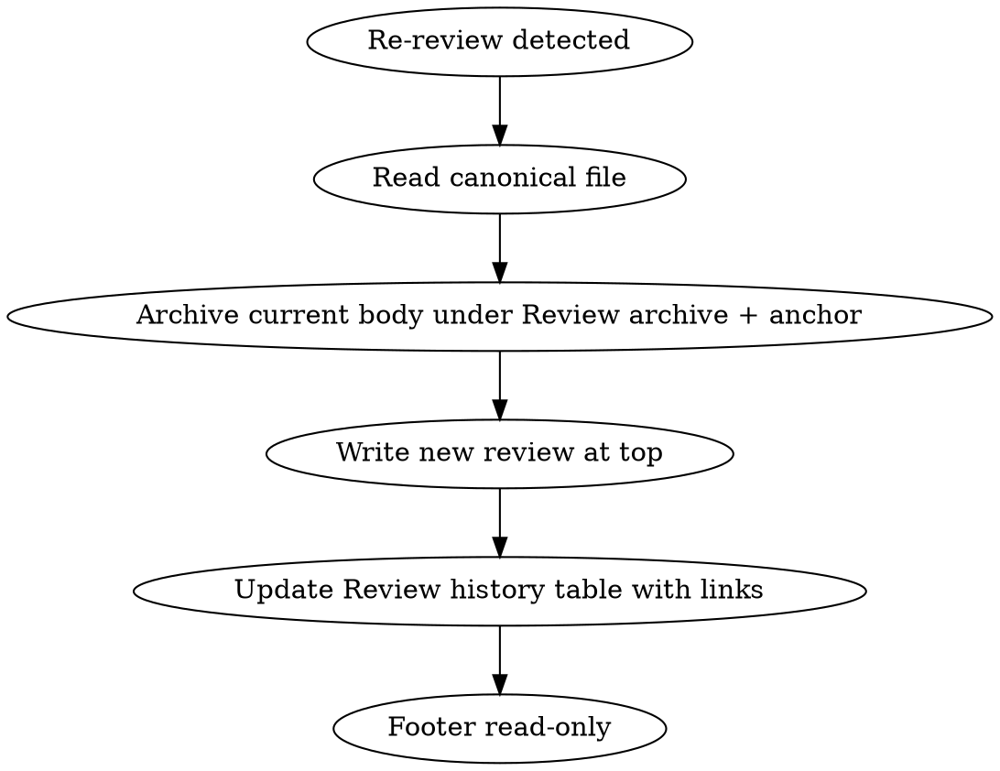

# `.reviews/` artifact format

> Reference for skill [`pr-review`](../SKILL.md). Load together with `flow-a-b.md`: this file is the document shape, the worked example, and the chat response.
>
> **artifacts, headings, and sample text are English. This file's fenced blocks are the literal output.**

## Output: `.reviews/` artifact

### Locale

**English.** UTF-8. Section headings below are English.

### Required document structure

Omit empty optional rows/sections rather than filling with "Not applicable" everywhere. For required analysis sections that truly have nothing (e.g. zero RCs): write a one-line note under the heading (`No RCs.`).

**Do not** include these removed sections: Scope reviewed; Tests and manual validation; Positives; Residual risks and rollback; Reviewer questions; Suggested GitHub comment (global); Status. Useful bits may go into Executive summary or Review history **Delta**.

#### Top matter (no numbered section)

1. **H1** — `# Review — <repo> · PR #<N>`
2. **Subtitle** — one line: PR title from MCP/`gh` (no Flow A/B, no "no action was taken on GitHub")
3. **Metadata table** — only these fields:

| Field | Notes |
|-------|--------|
| Date | `DD/MM/YYYY at HH:MM:SS` |
| PR | Markdown link to the PR |
| Repository | `owner/repo` |
| Author | display name + login when known |
| Base ← Head | branches |
| **Head SHA** | **Required on every write.** Full 40-char commit OID of the PR tip that was analyzed (`head.sha` / `headRefOid`). Used by the same-head early exit. |
| Diff | `+X / −Y · Z files` |
| Preliminary verdict | e.g. `` `request_changes` `` |
| **Findings** | **Required.** Counts, e.g. `3 RCs · 4 improvements · 3 questions`. Optionally note severity highlight (`1 blocker`). When a finding was barred by the verification gate or suppressed, append `· N unverified` — the number makes it visible when the gate is too tight. Update on every rewrite. |
| **Sibling PRs** | **Productive-base PR only.** Sibling links with per-PR state: `[#9029](…) APPROVED by @me · [#9144](…) MERGED without your approval`. See [`hml-prod-parity.md`](hml-prod-parity.md) |
| **Coverage** | **Productive-base PR only.** The surface in one line: `98.1% · 20 orphan lines · 2 from an unapproved PR`. When `exact`: `100% · no orphan lines` |
| **Change hash** | **Productive-base PR only.** `prodChangeHash` from `diff-coverage.mjs` — lets a revisit re-check parity without downloading the diffs again |

**Forbidden in header table:** Tip, Source, Focus. **Forbidden:** opening blockquote about Flow / GitHub unreadiness.

4. **`## PR links`** — structured table; omit rows with no data:

```markdown
## PR links

| Item | Detail |
|------|---------|
| Issue | [board#7100](…) |
| Title | … |
| State | `OPEN` |
| Requested reviewers | `login1`, `login2` |
| Published reviews | none |
```

#### Numbered sections

| # | Section | Notes |
|---|---------|--------|
| 1 | **Executive summary** | 3–8 lines. Optional short praise / positive security note here (no dedicated positives section). If **§5 sibling-base gate** was applied, state the sibling PR, the parity result and the effect on the verdict. |
| 2 | **Context** | Issue/card, acceptance criteria, wiki, sibling PRs; include the sibling PR and whether it was `APPROVED`/`MERGED` when this is a port. Subsection **`### Card coverage`** (required — see below). If §3.1.1 fired: subsection **`### Removals reviewed`** (table required). If §3.3 ran: subsection **`### Reviews already published`** |
| 3 | **CI and checks** | Status table only. Do **not** append a loose "GitHub reviews: …" line (that belongs in PR links). |
| 4 | **RCs** | `RC-NN` + technical fields + **Text to paste**. Under sibling-base parity: only findings **new** to the port (or a real regression in CI — billing alone does not count). |
| 5 | **Improvements** | `MEL-NN` + technical fields + **Text to paste**. Gaps already accepted on the sibling base belong here (or are omitted), not as an RC. **Cap of 3.** Anything beyond that becomes **one line** in Executive summary, not an item. Basis: an average of 2.68 improvements per artifact across 421 artifacts, and only **15%** reviewer engagement when an improvement is the only content (run 3). Improvement volume is not a measure of review quality. |
| 6 | **Questions for the author** | `Q-NN` — no mandatory Text to paste. The **Where** field (`path:line`) becomes required when the session may use `--comment`: without it the question cannot anchor in the diff and falls into the pending review body |
| 7 | **Security and sensitive data** | **Only if real security problems** (see below) |

Then (when applicable) **`## Unverified findings`** (appendix), then **`## Review archive`**
(archived prior bodies), then **`## Review history`**, then footer.

#### `### Card coverage` (inside section 2, required)

Output of § 2.1 of [`flow-a-b.md`](flow-a-b.md) — declared intent × what shipped.

```markdown
### Card coverage

| Aspect | Status |
|---------|----------|
| Declared intent | Allow reverting the status of an approved proposal (board#7100, 3 criteria) |
| Delivered | Revert route + service + S3 audit |
| Scope verdict | `missing requirement` |

- **Not covered:** card criterion 3 (notify the author of the reverted proposal) — no counterpart in the diff.
- **Out of scope:** `src/utils/date.ts` — a refactor mentioned neither on the card nor in the PR body.
```

Scope verdict: `clean`, `extra scope`, `missing requirement`, or the last two together. With no card and
no PR body, declare the source used (`intent inferred from the commits`) instead of dropping the subsection.

#### `### Delta versus the sibling base` (inside section 2, conditional — coverage < 90%)

Output of § 5.5 of [`flow-a-b.md`](flow-a-b.md). Only when sibling PRs **were** identified but coverage
did not reach the threshold, and the analysis was therefore complete.

```markdown
### Delta versus the sibling base

| Aspect | Status |
|---------|----------|
| Sibling PRs in the set | [#9029](…) `APPROVED by @me`, [#9116](…) `MERGED without your approval` |
| Coverage | 74.3% of 1068 lines — below the 90% threshold, full analysis |

Files with the most lines outside what you have already reviewed:

| File | Orphan lines |
|---------|--------------|
| `source/models/Indiky/WebNotificationClient/WebNotificationClientRepository.ts` | 61 |
| `source/features/WebNotification/WebNotificationController.ts` | 38 |
```

#### `## 2. Sibling-base RC status` (required in the parity artifact)

Output of step 4 of [`hml-prod-parity.md`](hml-prod-parity.md). One row per comment **you**
published on the sibling PR.

```markdown
## 2. Sibling-base RC status

| Sibling-base RC | Where | Status | Evidence in PROD |
|-----------|------|--------|-------------------|
| [#9029 comment](…) "missing await on the unset" | `UpdateProposalService.ts:210` | `addressed` | `await this.unset(...)` in `UpdateProposalService.ts:214` |
| [#9116 comment](…) "no index on fingerprint" | `WebNotificationClientSchema.ts:41` | `not addressed` | `fingerprint: { type: String }` — still without `index: true`, line 41 |
| [#9132 comment](…) "this is a naming nit" | `SelfContractRules.ts:12` | `not applicable` | It was a nit, no action requested |
```

`not addressed` becomes an `RC-NN` in section 4 and drives the verdict to `request_changes`.
`inconclusive` drives it to `approve_with_notes`. In both cases the parity banner does **not** appear.

#### `### Reviews already published` (inside section 2, conditional on § 3.3)

```markdown
### Reviews already published

| Author | Where | Class | Summary |
|-------|------|--------|--------|
| `Copilot` | `UpdateProposalService.ts:88` | valid | Missing await on the unset — becomes RC-02 |
| `Copilot` | `index.ts:12` | false positive | The import is used in the types block; evidence on line 40 |
| `mfernandanll` | `ForceStatusService.ts:31` | disagreement | See Q-01 |
```

`false positive` is **reserved for bots**. Disagreement with a **human** comment becomes a `Question` in
section 6 or a note in the Executive summary — never the false-positive label.

#### `## Unverified findings` (appendix, conditional)

Findings barred by the verification gate (they lacked a quotable excerpt). They exist so
calibration can be audited: if the appendix is always full while sections 4/5 are always empty, the gate
is too tight, and that is Flow C material.

```markdown
## Unverified findings

> They did not enter sections 4 and 5 for lack of citable evidence. They are not RCs.

| Dimension | Where | Suspicion | What was left unchecked |
|----------|------|----------|------------------------|
| `3. Performance :: N+1` | `ProposalService.ts:120` | Possible N+1 in the items populate | I did not confirm the real volume or whether an index exists |
```

Footer: `*Generated by the pr-review skill — local analysis only; no action was taken on GitHub.*`

### RC / Improvement item format

```markdown
### RC-01 — short title
- **Severity:** major
- **Checked:** yes
- **Dimension:** `1. Correctness :: silent partial failure`
- **Type:** RC
- **Where:** path:line
- **Evidence:** `verbatim excerpt that motivates the finding`
- **Problem:** …
- **Impact:** …
- **Suggested fix:** …
- **Repeat:** RC-03 from the review of 22/07/2026   <!-- only when applicable -->
- **Raised earlier by:** `Copilot` at `path:line`  <!-- only when it came from §3.3 -->


**Text to paste:**
> Block 1 — what breaks. Do not repeat the file: it is already in **Where**, and on GitHub the comment is born anchored to the line.
>
> Block 2 — when it breaks, with the concrete scenario.
>
> Block 3 — what to change. Self-contained: the developer fixes it **without reading the rest of the artifact**.
```

Same pattern for `MEL-NN` (Type: Improvement). One paste text per actionable RC/Improvement.

| New field | Rule |
|-----------|------|
| **Checked** | Required on RC and Improvement, `yes` or `no`. Binary: [`flow-a-b.md`](flow-a-b.md) § 4.2. `no` does **not** appear here — it goes to `## Unverified findings` |
| **Dimension** | Required on RC and Improvement. Which item of [`technical-checklist.md`](technical-checklist.md) produced the finding, as `<N. Dimension> :: <item>`. A finding that fits no existing item: write `— outside the checklist`, which signals a missing item. **This is what lets calibration measure which items never pay off** — without this field, run 3 could only classify 31% of findings |
| **Evidence** | Required. Verbatim excerpt with `file:line` proving the claim (§ 4.1). Without it the finding does not ship. For a framework-generated symbol: cite the construct that creates it (schema, decorator, migration), not the literal name |
| **Repeat** | Re-review only, when the finding was already in the archived revision (§ 4.4) |
| **Raised earlier by** | Only when the finding came from § 3.3 triage — it gives credit and stops the author reading it as a duplicate |

**`Checked`, `Dimension` and `Evidence` never enter the `Text to paste`.** They are instruments of
the reviewer and of Flow C; the paste block is written for the PR author. A `Checked: no` finding has
no paste text — it stayed in the appendix; if the reviewer still needs to know, it gets one line in
the Executive summary, in plain language (`I could not confirm it without running it; worth checking before merge`).

#### `Text to paste` rules (developer-facing)

This text **is** the RC — it goes to GitHub anchored in the diff and the PR author fixes the code from it.
Write it the way a colleague writes a PR comment: direct, short, no report register.

**Shape before content.** Blocks of one to three sentences, **separated by a blank line**. Three blocks is
the usual ceiling — what breaks · when it breaks · what to do. A six-line paragraph gets skimmed, and the
fix is usually at the end of it.

| Must carry | Detail |
|------------|--------|
| **What breaks** | The real condition in the code, not a paraphrase of the diff |
| **Concrete scenario** | Input → wrong state, when it helps pin the bug down |
| **Actionable fix** | What to change. More than one path only when both are defensible |
| **Verification** | When applicable, the test/assertion that proves the fix |

**Do not restate the location.** The comment is born anchored to `file:line` and the author is looking
right at the excerpt — in the artifact, the **Where** field sits one line above. Opening with
*"In `FormSimulation`, the `onSubmit` function…"* spends the first sentence saying what the screen already
says. Start with the problem: *"When submit fails, `loading` stays `true` forever."* Name another
file only when the finding **crosses** files — there the name is information, not echo.

**Tics that make the text read as generated.** Guard 4 of `--comment` catches none of these — they are on you:

| Tic | Instead |
|-----|---------|
| A bold label mirroring an artifact field (`**Problem:**`, `**Impact:**`, `**Suggestion:**`) | Prose. The fields are the reviewer's instrument; the author wants the sentence |
| Ceremonial opening — *"I noticed that…"*, *"It is worth considering…"*, *"It would be interesting…"* | The direct claim |
| Courtesy closing — *"Overall, great work!"*, *"Leaving this as a suggestion!"* | Nothing. A PR comment needs no goodbye |
| An impact paragraph that only restates the previous one | Cut it. If the impact is not obvious, one sentence; if it is, none |
| Three fix options when one is right | The right one. List an alternative only when you would hesitate yourself |
| A hedge that decides nothing — *"it might be that in some cases…"* | The exact condition. Without it the finding does not pass the § 4.1 gate |

- Light markdown is welcome: `inline code`, and a numbered list when the fix genuinely has steps. Headings, tables and nested quotes inside the comment, no.
- Anticipate misreadings: if the author might think "that's already handled", say what does **not** handle it (e.g. `force already calls the update service; the problem is not the delegation`).
- Do not depend on artifact-internal IDs (RC-NN, section numbers); the text must stand alone.
- A process blocker RC (e.g. red CI) may be short, but still says **what to do** to unblock.

### Security — conditional

Include `## 7. Security and sensitive data` **only** when there is a real security problem, e.g.:

- secret / credential in the diff
- auth bypass, IDOR, injection, XSS
- improper PII / sensitive data exposure
- weak permissions for a high-risk operation

**Do not** create the section for an all-positive security scan (AGX-only auth, private ACL, no secrets, etc.). Optionally one sentence in the Executive summary instead.

### Minimal example (shape reference)

```markdown
# Review — core · PR #8465

Authenticated proposal-status bypass (revert / force / backups)

| Field | Value |
|-------|--------|
| Date | 22/07/2026 at 12:33:02 |
| PR | [AGX-Software/core#8465](https://github.com/AGX-Software/core/pull/8465) |
| Repository | `AGX-Software/core` |
| Author | MathGueff (`Matheus Augusto Santos Gueff`) |
| Base ← Head | `main` ← `feature-branch` |
| Head SHA | `a1b2c3d4e5f6789012345678901234567890abcd` |
| Diff | +2665 / −32 · 25 files |
| Preliminary verdict | `request_changes` |
| Findings | 1 RC · 0 improvements · 0 questions (1 major) · 1 unverified |

## PR links

| Item | Detail |
|------|---------|
| Issue | [board#7100](https://github.com/AGX-Software/board/issues/7100) |
| State | `OPEN` |
| Requested reviewers | `reviewer-a`, `reviewer-b` |
| Published reviews | none |

## 1. Executive summary

The PR delivers a status bypass (revert/force/backups) restricted to Level.agx, with audit and S3.
There is a gap: force does not clear situationsDates when leaving approved/reproved. Verdict: `request_changes`.

## 2. Context

| Item | Detail |
|------|---------|
| Issue | [board#7100](…) — Postman feature to revert approve/reprove |

### Card coverage

| Aspect | Status |
|---------|----------|
| Declared intent | Revert approve/reprove via Postman, restricted to Level.agx (board#7100) |
| Delivered | Route + service for revert, force and backups, with S3 audit |
| Scope verdict | `clean` |

## 3. CI and checks

| Check | Status | Note |
|-------|--------|------------|
| Run Tests | fail | Blocks merge until green |

## 4. RCs

### RC-01 — `force` does not clear `situationsDates`
- **Severity:** major
- **Checked:** yes
- **Dimension:** `1. Correctness :: conditional side effect`
- **Type:** RC
- **Where:** `ForceProposalStatusService.ts:64`
- **Evidence:** `await this.updateProposal({ situation })` — without the `$unset` that `updateMultiple` does in `UpdateProposalService.ts:210`
- **Problem:** Revert and updateMultiple clear approved/reproved; force does not.
- **Impact:** Stale dates with the situation already changed.
- **Suggested fix:** In the update service, for force, apply the same unset.

**Text to paste:**
> When forcing a status out of approved/reproved, `situationsDates.approved|reproved` is not cleared — `revert` and `updateMultiple` do clear it.
>
> The record keeps the new situation and the old date, and anything that later reads `situationsDates` trusts that date.
>
> In the update service, for `forceProposalStatus`, apply the same unset `updateMultiple` uses.

## 5. Improvements

No improvements.

## 6. Questions for the author

No questions.

## Review history

| When | Verdict | Delta | Content |
|--------|----------|-------|----------|
| 22/07/2026 at 12:33:02 | `request_changes` | Initial review | **current** (above) |

---

*Generated by the pr-review skill — local analysis only; no action was taken on GitHub.*
```

---

## Parity artifact (productive PR, coverage ≥ 90%)

The **short** shape, used when the gate in [`hml-prod-parity.md`](hml-prod-parity.md) fires. It replaces
the 7 sections: they already ran on the sibling PR you approved. The **one canonical file per PR** contract and
the recorded `Head SHA` still apply.

Structure: top matter (with `Sibling PRs`, `Coverage`, `Change hash`) → `## 1. Parity` →
`## 2. Sibling-base RC status` → `## 3. Findings in the orphan lines` (only if there is surface) →
`## Review history` → footer. **No** Card coverage, Removals reviewed, detailed CI or
Improvements — none of that changed relative to what you already reviewed.

```markdown
# Review — core · PR #9148

[PROD-SERVER] 7833/7864 - Captura antecipada de Web Push + PushNews

> **These PRs are exactly the same as the sibling-base PRs you already approved — there is no review to do.**
> Coverage 100%, no orphan lines, and every RC you raised on the sibling base is addressed.

| Field | Value |
|-------|--------|
| Date | 17/09/2026 at 14:22:10 |
| PR | [AGX-Software/core#9148](https://github.com/AGX-Software/core/pull/9148) |
| Repository | `AGX-Software/core` |
| Author | … |
| Base ← Head | `production-server` ← `7833-7864-prod-server` |
| Head SHA | `a1b2…` |
| Sibling PRs | [#9029](…) `APPROVED by @me` · [#9116](…) `APPROVED by @me` |
| Coverage | 100% · no orphan lines |
| Change hash | `f3a9…` |
| Diff | +820 / −248 · 28 files |
| Preliminary verdict | `approve` |
| Findings | parity confirmed · 0 RCs |

## 1. Parity

| Aspect | Status |
|---------|----------|
| Siblings identified by | cards `7833`/`7864` in the title, confirmed by commit subject |
| Changed lines in PROD | 1068 |
| Covered by the union of approved sibling PRs | 1068 (100%) |
| Orphan lines | none |
| Covered only by a PR you did not approve | none |

## 2. Sibling-base RC status

(table — see above)

## Review history

| When | Verdict | Delta | Content |
|--------|----------|-------|----------|
| 17/09/2026 at 14:22:10 | `approve` | Sibling-base parity confirmed (100%) | **current** (above) |

---

*Generated by the pr-review skill — local analysis only; no action was taken on GitHub.*
```

**With a non-empty surface:** the banner blockquote does **not** appear. In its place, one line in
`## 1. Parity` stating how many lines fell outside, and section `## 3. Findings in the orphan lines` carrying
`RC-NN` / `MEL-NN` in the normal format — same checklist, same § 4.1 verification gate, only the scope is
those lines.

---

## Chat response (after saving)

### Single PR

1. Path to `.reviews/...`
2. Preliminary verdict (one line) — or `skipped_same_head` + prior verdict when early exit
3. Counts: RCs / improvements / questions (same as **Findings**), plus `N unverified` when any
4. **Card coverage** in one line — `clean`, `extra scope` or `missing requirement` (§ 2.1)
5. Top 3 findings (blocker/major first) — omit on `skipped_same_head` (point to existing file)
6. On skip: Head SHA + note that `--force` / `redo` reanalyzes
7. Reminder: *No action was taken on GitHub — use the markdown for your manual review.*

### `skipped_parity_hml` (productive PR with parity)

1. **First line, when the surface is empty:** that the PRs are exactly the ones already approved on the sibling base and
   that there is **no review to do**. That is the central point of this route — say it before anything else.
2. The sibling PRs in the set, with each one's state
3. Coverage and surface: `98.1% · 20 orphan lines in 6 files`
4. Sibling-base RC status as counts: `4 addressed · 1 not addressed · 0 inconclusive`
5. Findings from the orphan lines, if any
6. Artifact path + verdict
7. The usual GitHub reminder

Do **not** write item 1 when there is an orphan line, a `not addressed` RC or an `inconclusive` one — in those
cases there is review to do, and saying otherwise is this route's failure mode.

### With `--comment` (pending review published)

After the verdict and before the reminder, add: `reviewId`, how many comments anchored inline, how many fell
into the body, and that the review is **pending your submission** — no verdict was issued on GitHub. In a
batch, a `Pending review` column in the table.

### Batch (Flow B or multi-URL Flow A)

1. Table: `PR | Path | Verdict | Scope | RCs | Improvements | Questions | Skip?` — `Scope` is the § 2.1 verdict. Add a `Pending review` column only when the batch ran with `--comment`. `Skip?` carries `skipped_same_head`, `skipped_parity_hml` or `reused_for_comment` (not a skip: analysis reused, pending review published)
2. Optional: one-line note per PR if `insufficient` or `skipped_same_head`
3. Same mandatory GitHub reminder (once)

If `insufficient`: explain chain failure (MCP → 0.1 → 0.2); still save a partial file with the Executive summary + what evidence exists when any is available.

---

### Update in-place shape (re-review)



1. **Current revision body** = everything from H1 until (but not including) `## Review archive` / `## Review history` / footer.
2. **Before overwriting:** move that body into `## Review archive` (placed **before** Review history), wrapped as:

```markdown
<a id="review-2026-07-22-123302"></a>

### Review of 22/07/2026 at 12:33:02 — `request_changes`

(full content of the previous review)
```

   - Anchor id from the **previous** revision's Date / filename instant (`review-YYYY-MM-DD-HHMMSS`).
   - Preserve existing archived blocks already under `## Review archive` (newest archive on top or append consistently — keep chronological order clear).
3. Write the **new** review at the top of the file (H1 → sections per template).
4. Update `## Review history` (**last** section before footer):

```markdown
## Review history

| When | Verdict | Delta | Content |
|--------|----------|-------|----------|
| 22/07/2026 at 14:00:00 | `approve_with_notes` | tip moved; RC-02 resolved | **current** (above) |
| 22/07/2026 at 12:33:02 | `request_changes` | Initial review | [Review of 22/07/2026 at 12:33:02](#review-2026-07-22-123302) |
```

| Row | Content column |
|-----|-----------------|
| Newest (current) | `**current** (above)` — no link |
| Older | Markdown link to `#review-…` using the archived title |

- **Delta:** 1–3 lines (tip/head change, RCs new/resolved). Prefer mentioning short SHA when the tip moved (`head a1b2c3d → e4f5a6b`).
- **First create:** single Review history row "Initial review" with Content `**current** (above)`; omit `## Review archive`.

**Always** save/update the file when a **new analysis** ran (including when the user asked for a chat summary only). **Exception:** early exit `skipped_same_head` — **do not** rewrite the artifact.
